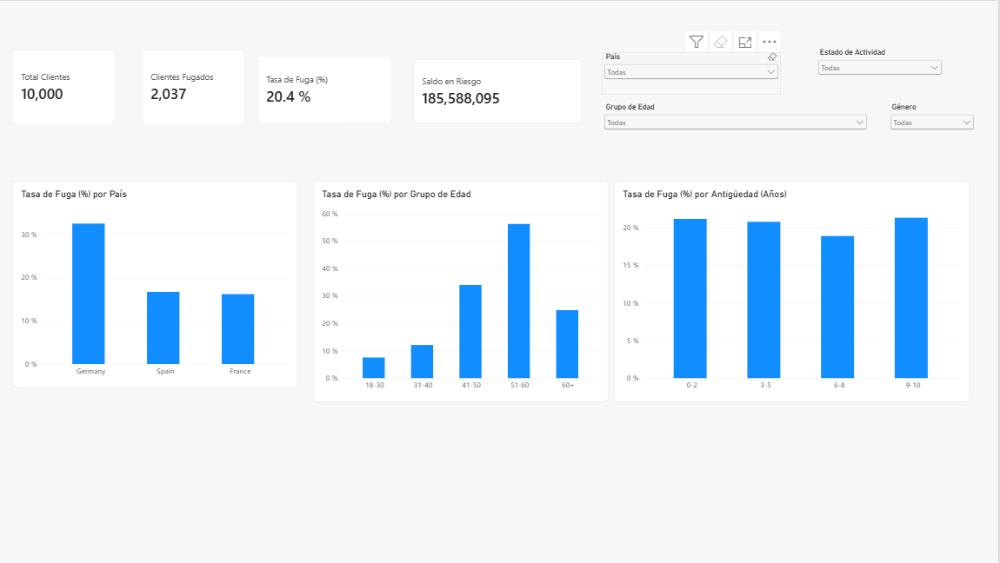
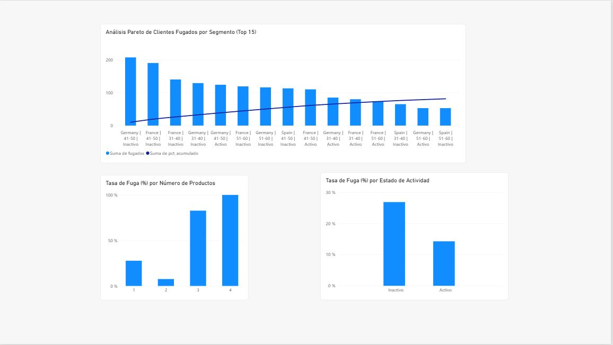
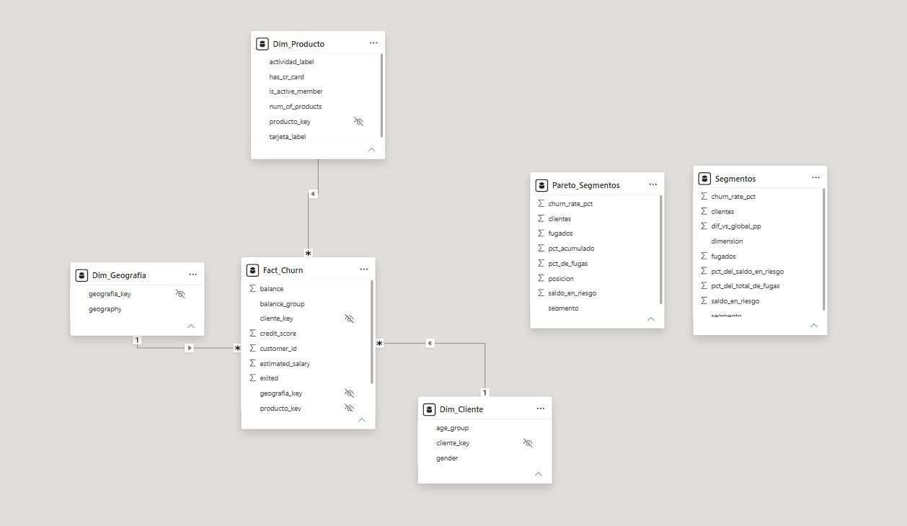

# Bank Customer Churn Analytics

Análisis de fuga de clientes de un banco con **SQL (PostgreSQL)**, **Python (EDA)** y **Power BI**, documentado en formato STAR.

> **Sobre los datos:** dataset público de Kaggle (*Bank Customer Churn / Churn Modelling*) de un **banco europeo** (clientes de Francia, España y Alemania). No es información de la banca peruana. Es un proyecto académico de portafolio.

---

## Situación

La pérdida de clientes cuesta dinero a un banco: cada cliente que se va se lleva su saldo y los ingresos futuros asociados. Este análisis parte de un dataset público de **10 000 clientes**, de los cuales **2 037 se fugaron** (tasa de fuga global de **20.37 %**).

## Tarea

Identificar **qué clientes se fugan y en qué segmentos se concentra la fuga**, y proponer acciones de retención priorizadas por impacto (clientes y saldo en riesgo). Construir además herramientas analíticas reutilizables: scripts SQL ordenados, un notebook de EDA y un dashboard.

## Acción

1. **SQL (PostgreSQL):** carga en una tabla *staging*, limpieza con tipos y clave primaria, chequeos de calidad, segmentación con `CASE WHEN`, KPIs con **CTEs**, **window functions** (`NTILE`, `PERCENT_RANK`, `RANK`, `LAG`), análisis de **Pareto** de segmentos y vistas de solo lectura para Power BI.
2. **Python (EDA):** pandas, matplotlib y seaborn: revisión y limpieza documentada, tasa de fuga por segmento, distribuciones, mapa de correlación y hallazgos de negocio.
3. **Power BI:** modelo estrella (`Fact_Churn` y 3 dimensiones) alimentado por las vistas de SQL, 10 medidas DAX y un dashboard de 2 páginas (resumen ejecutivo y perfil de riesgo).

## Resultado

| Indicador | Valor |
|---|---|
| Clientes analizados | 10 000 |
| Clientes fugados | 2 037 |
| Tasa de fuga global | 20.37 % |
| Saldo total | 764 858 892.88 |
| Saldo en riesgo (saldo de los fugados) | 185 588 094.63 (**24.26 %** del saldo total) |

*(El dataset no indica la moneda.)*

### Hallazgos principales

1. **La fuga se concentra en clientes de 41 a 60 años.** Los de 51-60 se fugan al **56.2 %** (n = 797) y los de 41-50 al **34.0 %** (n = 2 320), frente al 20.4 % global. Juntos son el 31.2 % de los clientes y concentran el **60.7 % de las fugas** y el 60.0 % del saldo en riesgo. Los menores de 40 están entre 7.5 % y 12.1 %. En 60+ baja a 24.8 % (n = 464): no es "a más edad, más fuga".
2. **Alemania pesa mucho más en dinero.** Tiene una tasa de **32.4 %** (n = 2 509) frente a ~16-17 % de Francia y España. Concentra el 40.0 % de las fugas pero el **52.8 % del saldo en riesgo**: los fugados alemanes dejan más saldo. El efecto del país se mantiene tanto en clientes activos como inactivos.
3. **Los clientes inactivos se fugan casi el doble:** 26.9 % (n = 4 849) frente a 14.3 % de los activos (n = 5 151).
4. **El número de productos muestra un patrón no lineal:** 2 productos tienen la menor fuga (7.6 %, n = 4 590), 1 producto 27.7 % (n = 5 084), y 3 y 4 productos 82.7 % (n = 266) y 100 % (n = 60). Los grupos de 3 y 4 productos son pequeños (326 clientes en total): se reporta con cautela.
5. **No distinguen a los fugados:** la antigüedad (18.9 %-21.3 % entre grupos), el credit score y el salario estimado.

### Pareto de segmentos (país | grupo de edad | actividad)

Se dividió la cartera en **30 segmentos** que no se solapan. **15 segmentos (50 %) concentran el 81.4 % de las fugas**: la fuga está concentrada, pero repartida: no se cumple una regla 80/20 estricta.

| # | Segmento | Fugados | Tasa de fuga | % acumulado de fugas |
|---|---|---|---|---|
| 1 | Germany \| 41-50 \| Inactivo | 207 | 55.95 % | 10.16 % |
| 2 | France \| 41-50 \| Inactivo | 190 | 34.36 % | 19.49 % |
| 3 | France \| 31-40 \| Inactivo | 140 | 11.86 % | 26.36 % |
| 4 | Germany \| 31-40 \| Inactivo | 129 | 25.44 % | 32.70 % |
| 5 | Germany \| 41-50 \| Activo | 124 | 40.26 % | 38.78 % |

El Pareto mide **volumen** de fugas: un segmento grande (como France | 31-40 | Inactivo) aparece arriba aunque su tasa sea baja. Por eso se lee junto con la tasa.

### Recomendación

**Priorizar un programa de retención para los clientes de 41 a 60 años**, empezando por los **inactivos de Alemania de 41-50 años** (207 fugados, 55.95 % de fuga, 10.2 % de todas las fugas). Este grupo de edad reúne el 60.7 % de las fugas y cerca del 60 % del saldo en riesgo. En paralelo, una campaña de **reactivación de clientes inactivos** (26.9 % de fuga). Se mediría comparando la tasa de fuga de los clientes contactados con un grupo de control.

### Dashboard

**Página 1: Resumen ejecutivo** (tarjetas, tasa de fuga por país, edad y antigüedad, con segmentadores)



**Página 2: Perfil de riesgo** (Pareto de los 15 segmentos con más fugados, tasa de fuga por número de productos y por actividad)



**Modelo estrella** (`Fact_Churn` y tres dimensiones; `Segmentos` y `Pareto_Segmentos` son tablas resumen sin relaciones):



---

## Calidad de los datos

Chequeos ejecutados en `sql/01_staging_y_limpieza.sql` (resultados del script `07`):

| Chequeo | Resultado |
|---|---|
| Filas cargadas / filas en tabla limpia | 10 000 / 10 000 |
| Filas con algún nulo o vacío | 0 |
| Duplicados por `CustomerId` | 0 |
| Filas fuera de rango (`Age`, `CreditScore`, `Tenure`, `Balance`, `NumOfProducts`, binarias 0/1) | 0 |

Decisiones de limpieza: se descartaron `RowNumber` (índice sin significado) y `Surname` (no aporta y es un dato personal innecesario).

## Estructura del repositorio

```
bank-customer-churn-analysis/
├── README.md
├── data/                       (aquí va Churn_Modelling.csv; ver "Cómo ejecutar")
├── sql/
│   ├── 00_crear_staging.sql
│   ├── 01_staging_y_limpieza.sql
│   ├── 02_segmentacion.sql
│   ├── 03_kpis_cte.sql
│   ├── 04_window_functions.sql
│   ├── 05_pareto_segmentos.sql
│   ├── 06_vistas_powerbi.sql
│   └── 07_resultados_readme.sql
├── notebooks/
│   └── eda_banco.ipynb
├── powerbi/
│   ├── bank_churn.pbix
│   ├── GUIA_POWERBI.md
│   └── capturas/
└── docs/
    ├── modelo_estrella.png
    └── eda_*.png
```

## Cómo ejecutar

**Requisitos:** PostgreSQL, Python 3 (pandas, numpy, matplotlib, seaborn, jupyter) y Power BI Desktop.

1. Descarga el dataset de Kaggle (*Bank Customer Churn / Churn Modelling*) y guárdalo como `data/Churn_Modelling.csv`. El archivo no se incluye en el repositorio.
2. En PostgreSQL, crea una base de datos y ejecuta **en este orden**:
   1. `sql/00_crear_staging.sql`: crea la tabla `stg_churn` vacía.
   2. **Importa el CSV en `stg_churn`** (con `\copy` en psql o con el asistente de importación de pgAdmin/DBeaver). Comprueba que hay 10 000 filas.
   3. `sql/01` a `sql/06`: limpieza, segmentación, KPIs, window functions, Pareto y vistas.
   4. `sql/07_resultados_readme.sql`: tabla resumen con las cifras de este README.
3. Notebook: abre `notebooks/eda_banco.ipynb` desde la carpeta `notebooks/` y ejecuta todas las celdas (lee `../data/Churn_Modelling.csv`).
4. Power BI: sigue `powerbi/GUIA_POWERBI.md` (conexión a las vistas `vw_*`) o abre `powerbi/bank_churn.pbix` y actualiza el origen de datos a tu PostgreSQL.

## Limitaciones

- **Sin fechas:** no se puede medir evolución en el tiempo ni estacionalidad. `Tenure` son años como cliente, no una fecha; por eso no hay análisis semanal o mensual.
- **Dataset público de un banco europeo,** sin información de cómo se generó o muestreó: no representa a la banca peruana.
- **Correlación no implica causalidad:** los patrones son asociaciones.
- **Tasa de fuga ≠ probabilidad individual:** no hay modelo predictivo (la regresión logística queda como mejora futura).
- **Saldo en riesgo** es el saldo registrado de los clientes fugados, no una pérdida económica real.
- **Grupos pequeños con tasas extremas** (3 y 4 productos: 82.7 % con n = 266 y 100 % con n = 60): poco estables y posiblemente un artefacto del dataset.
- **Variables analizadas por separado:** solo se cruzaron país × actividad y el segmento compuesto del Pareto; no se controló el efecto conjunto de todas las variables y no se hicieron pruebas de significancia.
- **Cortes de los grupos** (edad, saldo, antigüedad) son decisiones del análisis; otros cortes podrían cambiar la lectura.
- **Muchos clientes sin saldo:** el 36 % tiene balance = 0, por lo que se analiza como grupo propio.

## Tecnologías

PostgreSQL · SQL (CTEs, window functions) · Python (pandas, matplotlib, seaborn) · Power BI (modelo estrella, DAX) · Git

## Autor

*[Tu nombre]*: [LinkedIn](https://www.linkedin.com/) · [GitHub](https://github.com/Getaway2022)